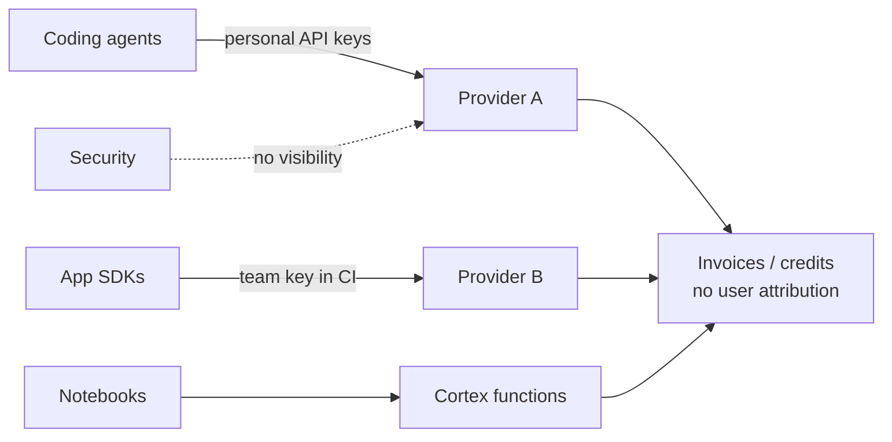
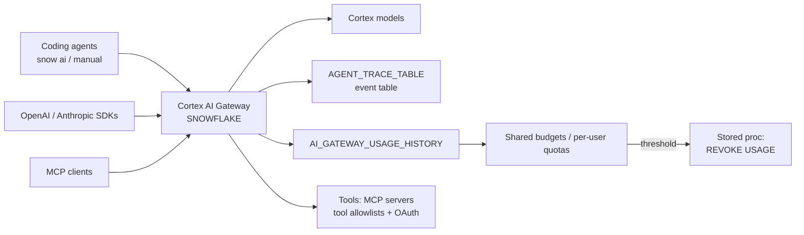

# Architecture

## The problem this solves

Most organizations adopted LLMs the way they adopted SaaS: one team at a time. Provider API keys live in CI secrets, personal tokens, and notebooks. Finance gets one bill with no team attribution. Security cannot say which prompts left the building. Platform engineering is asked to "govern AI" with no control point to govern from.

The friction is not the models. It is that there is no single path traffic must take, so identity, logging, and limits have nowhere to attach.

## Before: many unmanaged paths

## After: one governed path

## What the change removes / adds

**Removes:** provider API keys scattered across secret stores; homegrown LLM proxies kept alive only for logging; manual chargeback spreadsheets.

**Adds:** a gateway spec managed as code; a trace event table that becomes sensitive once payload capture is on; a single dependency for all AI traffic.

## Key architectural properties

1. **One gateway per account, named `SNOWFLAKE`, auto-provisioned.** Nothing to create; only privileges and spec to manage.
2. **Open by default.** `USAGE` is granted to `PUBLIC`. Production must be default-deny (revoke `PUBLIC` first).
3. **Path ≠ entitlement.** `USAGE` on the gateway does not widen model access; requests still need `SNOWFLAKE.CORTEX_USER` or model-level controls. This separation is what makes forcing all traffic through one chokepoint safe.
4. **Path ≠ oversight.** `USAGE` sends inference; `MONITOR` reads all usage and every user's traces. A `USAGE`-only role reads only its own spans.
5. **Not the ML gateway.** Cortex AI Gateway governs Cortex AI inference (model access, cost, traces). The Snowflake ML `GATEWAY` object routes traffic across serving endpoints (splitting/shadowing). Different objects.

## Trust boundaries

| Boundary | Risk | Control |
|---|---|---|
| Gateway endpoint | Unauthenticated/unattributed traffic | Snowflake token auth (OAuth / key-pair JWT / PAT); `USAGE` grant; default-deny |
| Model access | Privilege escalation through gateway | Entitlement checked separately (`CORTEX_USER` / model ACLs) |
| Trace event table | Prompt/response content at rest once payload capture is on | Classify as sensitive; restrict access; retention policy; `exclude_tags` for named users |
| `MONITOR` privilege | Reading every user's traces | Treat as a data-access grant; small membership |
| Exclude tag `APPLY` | Anyone who can apply the tag can disable prompt auditing for a user | Dedicated tag; `APPLY` restricted to security role; audit global `APPLY TAG` |
| Spec change | Silent config regression (full-replacement API) | Spec in Git + PR review + CI drift check |
| MCP Tools (preview) | Agents acting on third-party systems | Per-user OAuth; tool-level allowlists (default = all tools); ACCOUNTADMIN-only administration |

## ADRs

### ADR-1: Explicit model allow-list over `'*'`

**Decision:** `config/gateway-spec.production.yaml` lists models explicitly.

**Rationale:** `'*'` exposes every model the account can reach, including models added tomorrow, with no review of cost or fit. An allow-list makes model onboarding a reviewed PR.

**Consequence:** New models require a spec PR. Accepted — that review is the point.

### ADR-2: Spec managed as code, applied in full

**Decision:** The spec lives in `config/`; `sql/03_apply_spec.sql` mirrors it; CI validates and drift-checks.

**Rationale:** `ALTER ... FROM SPECIFICATION` replaces the entire spec. A hand edit that omits `capture_payload` silently reverts it to default. Full-replacement APIs demand version control and verification.

### ADR-3: Payload capture is a data-classification decision

**Decision:** `request_response: true` in production, with a dedicated exclusion tag and documented trace-table sensitivity.

**Rationale:** Prompt capture is the only way to fully reconstruct what AI did for a user — but it stores customer content in an event table in your account. Enable deliberately, with retention and access controls, not as a debugging toggle.

### ADR-4: Quotas as backstop, budgets as accountability

**Decision:** Per-user quotas (built-in blocking, applies within minutes) guard against runaway loops; shared budgets (periodic, up to ~6.5h / 1h low-latency) provide team-level showback and threshold actions.

**Rationale:** Budgets are periodic — a loop can overshoot for hours before a budget action fires. Only quotas and revokes actually stop spend in time.
